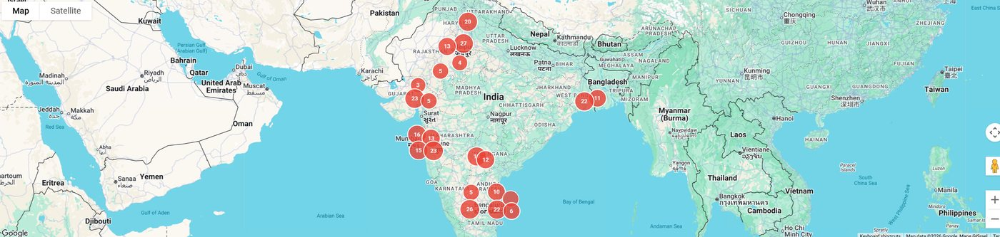
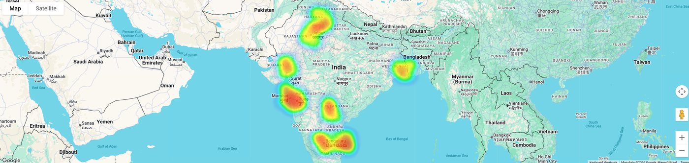
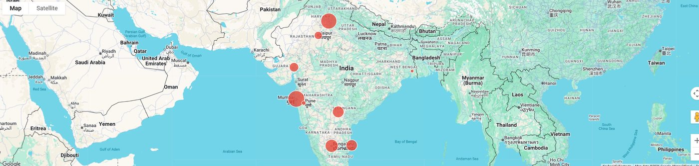
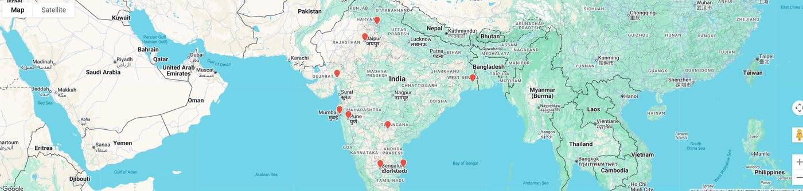
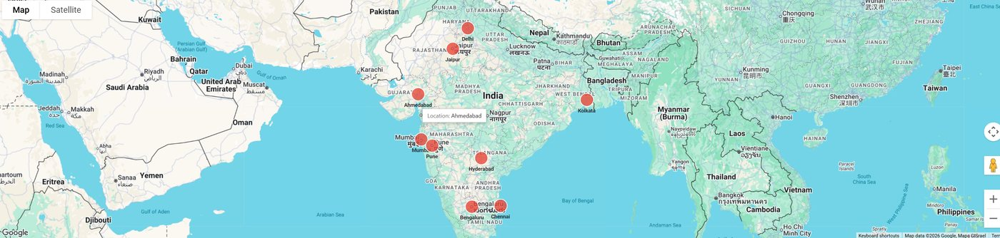
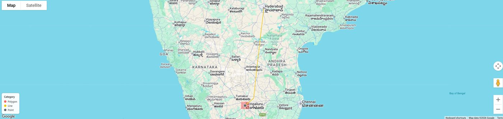

# Google Maps visual for Power BI

A Power BI custom visual (`pbiviz`, API 5.x, TypeScript) that puts a Google Map in any report. You can import it into any report and drive it from data fields.

> **License:** [PolyForm Noncommercial 1.0.0](LICENSE.md). It's free for personal, educational, research and non-profit use. **Commercial use requires a paid license.** See [License](#license).

## Features

| Area | What it does |
|---|---|
| **Pins / bubbles** | Pin or circle markers. Size scales by area from a measure. Color comes from Legend or a gradient. Optional labels. |
| **Clustering** | Built-in grid clustering, recalculated on zoom. Click a cluster to zoom in; Ctrl+click selects all its points. |
| **Lines / routes** | Rows with the same **Path ID**, sorted by **Path order**, become polylines. Options: geodesic, direction arrows, length in the tooltip. |
| **Geography (shapes)** | A **Geometry** column holding GeoJSON *or* WKT (Point/Line/Polygon/Multi*/GeometryCollection). This works directly with SQL `geography.STAsText()`. |
| **Choropleth** | **GeoJSON URL** for boundaries (states, districts, pincodes). Features join to the **Location** field through a property name (default `name`) and are colored by Legend or a gradient. |
| **Heatmap** | Custom canvas heatmap, weighted by Size. Google removed its own HeatmapLayer in May 2026, so the visual draws its own. |
| **Geocoding** | Rows that have **Location** but no lat/long are geocoded with Google, cached for the session and throttled. |
| **Map options** | Roadmap / satellite / hybrid / terrain, Style JSON, Map ID (cloud styling and Advanced Markers), traffic / transit / bicycling layers, auto-zoom to data, controls on/off. |
| **Power BI integration** | Cross-filtering and highlighting (click, Ctrl+click, click the map to clear), bookmark-aware selection, native tooltips plus report-page tooltips, right-click context menu (drill-through), legend, landing page, up to 500,000 rows (loaded in chunks). |

## Screenshots

Captured from the [test app](sample-angular-app/), which runs the visual with the same data and settings you would use in Power BI.

**Clustering:** nearby points grouped into numbered clusters that split as you zoom.


**Heatmap:** weighted by the Size field.


**Bubbles:** circle area scales with a measure.


**Pins:** classic markers from latitude and longitude.


**Marker labels:** names under each marker, with a native-style tooltip on hover.


**Shapes from GeoJSON:** a polygon, a line and a point from one Geometry column, with a legend.


## Data fields

| Field | Use |
|---|---|
| Location / Address / Key | Point name, an address to geocode, or the GeoJSON join key |
| Latitude, Longitude | Decimal degrees. Set them to **Don't summarize**. |
| Legend | Category color |
| Size / Weight | Bubble size and heatmap weight |
| Color saturation | Gradient color (when Legend is empty) |
| Path / Route ID + Path order | Lines |
| Geometry (GeoJSON / WKT) | Shapes per row |
| Tooltips | Extra tooltip measures |

## Build

Requirements: Node 18+.

```bash
npm install -g powerbi-visuals-tools     # gives the `pbiviz` command
npm install
pbiviz install-cert                      # one time, for the dev server
pbiviz start                             # live dev in Power BI Service (Developer visual)
pbiviz package                           # -> dist/googleMapsVisual*.pbiviz
```

If `npm install` reports version conflicts, bump `powerbi-visuals-api` in `package.json` and `apiVersion` in `pbiviz.json` to the version that `pbiviz new test` generates on your machine.

`pbiviz package` produces the file you give to report authors: `dist/googleMapsVisual.<guid>.<version>.pbiviz`. The next section shows how to use it.

## Using the visual in a Power BI report

### Step 1: Get the visual into Power BI

Pick **one** of these three options.

**A. Power BI Desktop (single report, quickest to try)**

1. Open Power BI Desktop and go to **File → Options and settings → Options**.
2. Under **Current file → Report settings**, tick **Developer mode → Turn on developer mode for this session**, then click **OK**. Desktop needs this to import a visual from a file, and it resets every session.
3. In the **Visualizations** pane, click **…** (Get more visuals) → **Import a visual from a file**.
4. Select the `.pbiviz` file. A red map-pin icon appears at the bottom of the Visualizations pane.
5. Optional: right-click the icon → **Pin to visualization pane** so it's there in future reports.

The visual is saved inside the `.pbix`, so anyone you share the report with sees it too.

**B. Power BI Service (browser)**

1. Open a report and click **Edit**.
2. In **Visualizations**, click **…** → **Import a visual from a file** and select the `.pbiviz`.

This needs the tenant setting **Allow visuals created using the Power BI SDK**, which is *disabled by default*. Ask your Fabric admin to enable it under **Admin portal → Tenant settings → Power BI visuals**.

**C. Organizational visual (recommended for teams and clients)**

A Fabric / Power BI admin does this once:

1. Go to **Settings (gear) → Admin portal → Organizational visuals → Add visual → From a file**.
2. Upload the `.pbiviz`, give it a name such as "Google Maps", and optionally tick **Enable for all users** so it shows in everyone's Visualizations pane.

Organizational visuals:
- work even when the tenant blocks uncertified visuals
- deploy automatically to Power BI Desktop
- update every report that uses the visual when you upload a new version

They are not supported in Power BI Report Server.

### Step 2: Add the map to a page

1. Click the **Google Maps** icon in Visualizations, then drag the empty visual to size it on the canvas.
2. Go to **Format visual → Map → Google Maps API key** and paste your key (see *Google setup* below). The map appears.
3. Drag fields from your data into the field wells. For coordinate columns, open the field's dropdown and choose **Don't summarize**. Otherwise Power BI sums them and the points land in the wrong place.

### Step 3: Map your fields to what you want to show

| You want… | Put these fields in the wells | Then in Format visual |
|---|---|---|
| **Pins for stores/assets** | Location (name), Latitude, Longitude, optionally Legend (type) | Markers → Shape = Pin |
| **Bubbles sized by a value** | Latitude, Longitude, Size (e.g. Sales) | Markers → Shape = Circle; set Min/Max bubble size |
| **Colored by a value** | Latitude, Longitude, Color saturation (e.g. Margin) | Data colors → Gradient on; pick min/max colors |
| **Many points (10k+)** | Latitude, Longitude | Markers → Cluster markers = On |
| **Routes / trips / lines** | Latitude, Longitude, Path / Route ID, Path order (sequence or timestamp) | Lines → arrows, width, geodesic |
| **Polygons from your database** | Location, Geometry (WKT, e.g. `geo.STAsText()` from SQL, or GeoJSON text) | Geography → fill opacity, border |
| **Colored states/districts (choropleth)** | Location (must match a property in the GeoJSON, e.g. state name), Color saturation or Legend | Geography → GeoJSON URL, *property to join* (e.g. `name`) |
| **Heatmap** | Latitude, Longitude, optional Size as weight | Heatmap → Show = On; Markers → Show = Off |
| **Addresses only, no coordinates** | Location (full address) | Geocoding → On (needs Geocoding API on the key) |
| **Extra info on hover** | Any measures in Tooltips | — |

You can combine these. For example, one visual can show store pins, delivery routes and zone polygons at the same time, as in `sample-data/sample.csv`.

### Step 4: Interact (works like built-in visuals)

- **Click** a pin, line or shape to cross-filter the other visuals on the page. **Ctrl+click** adds to the selection. **Click empty map** clears it.
- **Click a cluster** to zoom in. **Ctrl+click a cluster** selects every point in it.
- **Right-click** opens the Power BI context menu, including **Drill through** if your report has drill-through pages.
- **Report-page tooltips:** in **Format visual → General → Tooltips**, set Type = *Report page* and choose your tooltip page.
- Slicers and filters on the page filter the map automatically.
- Bookmarks save and restore the map's selection.

### Step 5: Publish and share

1. In Desktop, click **Publish** and choose a workspace.
2. Viewers need nothing extra. If you used option B, the tenant setting must still be enabled for them.
3. The API key travels inside the report, so share only with people you trust to use your key's quota.

### Using the visual in your own application (embedding)

The visual runs inside a Power BI report, so to put it in a web app you embed that report with Power BI Embedded. The steps below use Angular, but any front end works the same way.

**Prerequisites**

- A published report that contains the visual (Steps 1-5 above), in a workspace on Fabric / Power BI capacity (F, P or A SKU).
- An Azure AD app registration (service principal) that is a member of that workspace and allowed to use Power BI APIs.
- The visual saved inside the report. Importing the `.pbiviz` into the `.pbix` in Desktop (option A) is the simplest route. Check Microsoft's embedding documentation before relying on organizational visuals in an embed.

**Steps**

1. Add a backend endpoint (for example `GET /api/powerbi/embed-config`) that gets an Azure AD token for the service principal, reads the report's `embedUrl`, calls **Generate Token** with `accessLevel: View`, and returns `{ reportId, embedUrl, embedToken }`. Keep the service principal secret on the server.
2. In the front end: `npm install powerbi-client`.
3. Embed the report:

```ts
import * as pbi from 'powerbi-client';

const service = new pbi.service.Service(
  pbi.factories.hpmFactory, pbi.factories.wpmpFactory, pbi.factories.routerFactory);

const { reportId, embedUrl, embedToken } = await (await fetch('/api/powerbi/embed-config')).json();

service.embed(hostElement, {
  type: 'report',
  id: reportId,
  embedUrl,
  accessToken: embedToken,
  tokenType: pbi.models.TokenType.Embed,
  settings: { panes: { filters: { visible: false } } }
});
```

4. Serve the app over HTTPS and allow `maps.googleapis.com` through your network or proxy.
5. The Google key is stored in the report (Step 2), and the HTTP-referrer restriction rule from *Google setup* applies to embedded reports too.

The [`sample-angular-app`](sample-angular-app/) has a **How to setup** page with the same steps and a ready-to-copy Angular component.

### Testing locally without Power BI

[`sample-angular-app/`](sample-angular-app/) runs this visual in a browser with a mock Power BI host and an examples menu for each feature. See its README.

### Updating the visual later

1. Increase `version` in `pbiviz.json` (for example `1.0.1.0`), then run `pbiviz package`.
2. Install the new file:
   - **Option A/B:** re-import the new `.pbiviz` into each report. Power BI replaces the old version.
   - **Option C:** admin portal → Organizational visuals → the visual's **⋯ → Settings → Update**. Every report picks it up.

### Developing against a live report (optional)

`pbiviz start` serves the visual from your machine:

1. In the Power BI Service, go to **Settings → Developer settings → Turn on developer mode**. In Desktop, the equivalent is **File → Options → Report settings → Develop a visual**.
2. Add the **Developer visual** (`</>` icon) from the Visualizations pane.
3. It reloads each time you save code.

### Troubleshooting

| Symptom | Fix |
|---|---|
| "Google rejected the API key" | Enable Maps JavaScript API and billing; remove **HTTP-referrer** restrictions from the key (Power BI's sandbox has no origin). Use API restrictions instead. |
| Map is grey / script blocked | The visual's WebAccess privilege must include Google's domains (it does by default). Check that your network or proxy allows `maps.googleapis.com`. |
| Points in the ocean / one point at 0,0 | Latitude and longitude are being summed or swapped. Set both to **Don't summarize** and check which column is which. |
| Shapes don't appear | WKT must be `lng lat` order (SQL `STAsText()` already is). For a GeoJSON URL, add its host to `WebAccess` in `capabilities.json` and re-package. |
| Choropleth regions all grey | The Location values don't match the GeoJSON property. Check *property to join* and the spelling (matching ignores case and surrounding spaces). |
| Changed the API key but nothing happens | Reload the report page; Google Maps can only load once per page. |
| Import option is greyed out / visual blocked | Turn on developer mode (Desktop), or ask the admin to enable *Allow visuals created using the Power BI SDK*, or use option C. |

## Google setup

1. In Google Cloud Console, enable **Maps JavaScript API**, plus **Geocoding API** if you use geocoding, and turn on billing.
2. Create an API key. **Use API restrictions, not HTTP-referrer restrictions.** Power BI runs visuals in a sandboxed iframe with a `null` origin, so referrer-restricted keys are rejected.
3. Optional: create a **Map ID** (JavaScript, vector). It enables Advanced Markers and cloud-based styling. `DEMO_MAP_ID` works for testing. With a Map ID set, *Style JSON* is ignored (Google's rule), so style the map in the Cloud Console instead.
4. Paste the key in **Format visual → Map → Google Maps API key**.

> The key is saved in the report, so anyone who can edit the report can read it. Use a dedicated key with API restrictions and quotas.

## Working with large data

### How loading works

Power BI sends rows to a visual in chunks of at most 30,000. This visual asks for the next chunk until all rows have arrived, so a 500,000-row table is delivered as about 17 chunks.

1. The first chunk arrives and the map is drawn from it straight away.
2. While more chunks arrive, a note in the corner of the map shows "Loading data… N rows so far". The map is not redrawn for each chunk, so the page stays responsive.
3. When the last chunk is in (or the limit is reached), the map is drawn once with all rows and the note disappears.

Settings are in **Format visual → Data loading**:

| Setting | Default | What it does |
|---|---|---|
| Load all rows (in chunks of 30,000) | On | Off keeps only the first 30,000 rows and shows a note that more data exists. |
| Max rows to load | 500,000 | Stops requesting chunks once this many rows have arrived. Rows beyond it are left out and a note says so. |

To keep zooming and panning smooth with many points, turn **Markers → Cluster markers** on. For large data sets the visual then clusters only the visible area (plus a margin) and caps the number of markers drawn using **Max markers**. Panning past the drawn area redraws it.

### Limits

- **Power BI caps custom visuals at about 1 million rows**, whatever you set in *Max rows to load*.
- **Loading takes time.** Every chunk is a separate request to your data source, so 500,000 rows can take noticeably longer than 30,000, and the report holds all rows in memory. DirectQuery sources are slower than imported data.
- **Rows left out are not random.** If you hit the limit, you get whichever rows Power BI delivers first. Filter or aggregate the data instead of relying on the cut-off.
- **No clustering means a marker cap.** Without clustering, only *Max markers* points (default 5,000) are drawn, and a note says so.
- **Selecting a huge cluster is slow.** Ctrl+click on a cluster that holds many thousands of rows has to build a selection for each of them.
- **Heavy columns multiply the cost.** A Geometry column (GeoJSON / WKT) per row, or geocoding many addresses, is far more expensive than plain latitude and longitude. Geocode once in your pipeline and store the coordinates.
- These numbers come from tests with synthetic data in a browser. I have not measured a real 500,000-row Power BI report, so check how your own data source behaves.

### Optimization: aggregate to a grid first

The fastest map is one that receives fewer rows. If you want to see density rather than individual records, group the points into grid cells **in your data source before the visual**. This is a data-preparation step in SQL, Power Query or the data model. It is not part of the visual, and the visual needs no change for it.

Round latitude and longitude to a grid, then count (or sum) the rows in each cell:

| Decimal places | Cell size (about) |
|---|---|
| 0 | 111 km |
| 1 | 11 km |
| 2 | 1.1 km |
| 3 | 110 m |

Longitude cells get narrower away from the equator.

**SQL (a view or the query you import):**

```sql
SELECT ROUND(Latitude, 2)  AS Lat,
       ROUND(Longitude, 2) AS Lng,
       COUNT(*)            AS Points,
       SUM(Sales)          AS Sales
FROM   Locations
GROUP BY ROUND(Latitude, 2), ROUND(Longitude, 2)
```

**Power Query (Transform data → Advanced Editor):**

```
let
    Source  = Locations,
    Rounded = Table.TransformColumns(Source, {
        {"Latitude",  each Number.Round(_, 2), type number},
        {"Longitude", each Number.Round(_, 2), type number}}),
    Grouped = Table.Group(Rounded, {"Latitude", "Longitude"}, {
        {"Points", each Table.RowCount(_), Int64.Type},
        {"Sales",  each List.Sum([Sales]), type number}})
in
    Grouped
```

Then in the report:

| Field well | Put |
|---|---|
| Latitude, Longitude | The rounded columns (set to **Don't summarize**) |
| Size | `Points` (or a sum such as `Sales`) |

- For a **heatmap**, turn Heatmap → Show on and Markers → Show off. Size becomes the weight of each cell.
- For **bubbles**, Size scales each bubble by the number of points in its cell.

What you give up: individual records. You can't click one point or see its own tooltip, only the cell's totals. A common pattern is a grid map for the overview and a second page, filtered to a small area, that shows the raw points.

## Things to know

- **Not AppSource-certifiable.** Certified visuals may not call external services. Distribute this one as an organizational visual. The `WebAccess` privilege in `capabilities.json` lists the Google domains it needs.
- **GeoJSON URLs** must be on a host listed in `WebAccess` (`raw.githubusercontent.com` is included as an example). Add your own host and re-package.
- **Changing the API key** requires reloading the report page, because Google Maps can only be loaded once per page.
- **Geocoding** costs money per request and is rate-limited. For more than a few hundred addresses, geocode once in your pipeline (Power Query, SQL) and store lat/long.
- **Large data (up to 500,000 rows).** Loaded in chunks of 30,000 rows. See [Working with large data](#working-with-large-data) for the settings, limits and how to aggregate first.
- **Performance.** Selection ids and tooltips are built only when needed. Without clustering, the *Max markers* setting caps rendering (default 5,000).
- **Deprecated Google features avoided:** `HeatmapLayer` and `KmlLayer` (removed), the Drawing library (deprecated). Classic `Marker` is used only when no Map ID is set.
- **Licensing.** Your use must follow the Google Maps Platform Terms, including attribution, which the map shows automatically.

## Project layout

```
capabilities.json      data roles, formatting objects, WebAccess privilege
pbiviz.json            visual metadata
src/visual.ts          map lifecycle, markers, clusters, lines, shapes, selection, tooltips, geocoding
src/settings.ts        Format pane (formatting model)
src/dataParser.ts      table dataView -> rows, colors, tooltips
src/geometry.ts        GeoJSON / WKT parsing
src/clustering.ts      grid clustering
src/heatmapOverlay.ts  canvas heatmap OverlayView
src/mapsLoader.ts      Google Maps script loader + auth-failure hook
style/visual.less      styles
sample-data/sample.csv stores, routes and WKT zones to try it out
```

## Trying the sample

Load `sample-data/sample.csv`, then map:

- Location → Location
- Latitude / Longitude → Latitude / Longitude
- Category → Legend
- Sales → Size
- RouteId → Path ID
- Seq → Path order
- Geometry → Geometry

## License

Copyright (c) 2026 Rahul Solanki.

This project is licensed under the **[PolyForm Noncommercial License 1.0.0](LICENSE.md)**.

**Free, no permission needed:**
- personal projects, study, research and experimentation
- charities, educational institutions, public research organizations, public health/safety and government bodies

**Needs a commercial license:**
- use by or for a company in its business, such as internal company reports or dashboards
- reselling or bundling the visual
- building it into products or client deliverables
- offering it as part of paid services

Every copy you share must include the `LICENSE.md` file (or its URL) and the `Required Notice:` line at the top of it.

**Commercial licensing:** contact Rahul Solanki through [github.com/RahulSolanki1487](https://github.com/RahulSolanki1487) or open an issue in this repository.

### Third-party terms

This license covers only the code in this repository.
- **Google Maps Platform:** using the visual also requires your own Google Maps Platform API key and acceptance of the [Google Maps Platform Terms of Service](https://cloud.google.com/maps-platform/terms). Charges for map loads and geocoding requests are billed by Google to the key owner.
- **Microsoft:** the Power BI packages this project depends on (`powerbi-visuals-api`, `powerbi-visuals-tools`, `powerbi-visuals-utils-formattingmodel`) are distributed by Microsoft under their own licenses.
